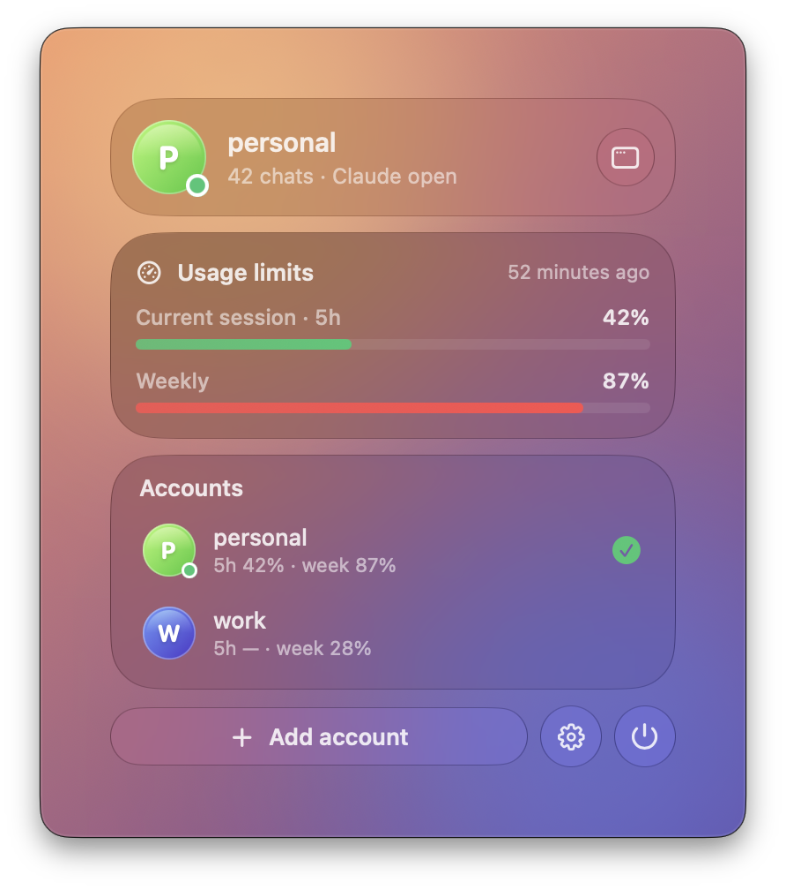
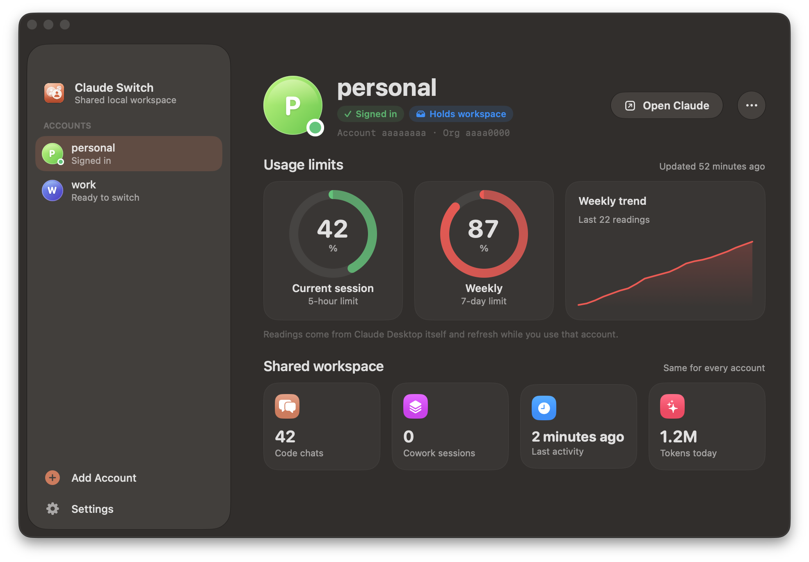

<p align="center">
  
</p>

<h1 align="center">Claude Switch</h1>

<p align="center">
  <b>English</b> | <a href="README.ru.md">Русский</a>
</p>

<p align="center">
  <b>Switch accounts in Claude Desktop on macOS while keeping your local chats shared.</b><br>
  A native menu bar app with Liquid Glass, usage limits at a glance, and a CLI.
</p>

<p align="center">
  
  &nbsp;
  
</p>

Normally, if you sign out of Claude Desktop and sign in with another account, the Code (and Cowork) tab comes up empty, because local sessions are tied to the account. Claude Switch remembers the sign-ins of several accounts and switches between them with one click in the menu bar. All your local chats move with you to whichever account is active.

You can also do everything from the terminal:

```text
$ claude-switch list
 ● main                 c4d2a3b1/fb6c95e4  active  ← workspace
   work                 9a1e77f0/2b4d1c88  sign-in saved

$ claude-switch use work
[12:04:10] Quitting Claude… (confirm if the app asks)
[12:04:13] Sign-in for 'main' saved
[12:04:13] Moving workspace c4d2a3b1/fb6c95e4 → 9a1e77f0/2b4d1c88
[12:04:13] Switched to 'work'. Launching Claude.
```

- **Lives in the menu bar.** A Control Center-style glass panel shows who you're signed in as, your 5-hour and weekly limits, and every account one click away.
- **Usage limits for every account.** The current session (5-hour) and weekly limits, with a weekly trend, taken from Claude Desktop's own readings.
- **One-click switching.** From the menu bar, the app window, or `claude-switch use <name>`.
- **Shared local workspace.** Code and Cowork sessions, scheduled tasks, sidebar groups, per-folder permission modes and session presets move with every switch.
- **No signing in again.** Each account's sign-in is saved locally and restored when you switch back.
- **Backup before every change.** The last 8 are kept in `~/.claude-switch/backups/`.
- **Native and light.** SwiftUI with real Liquid Glass on macOS 26 and later (vibrancy on older systems); the switching engine is one Python file with no dependencies.

> [!IMPORTANT]
> This is an unofficial tool and is not affiliated with Anthropic. It relies on Claude Desktop's internal data layout, which may change in a future update. Tested with Claude Desktop 4.4212 on macOS (Apple Silicon).

## Contents

- [Requirements](#requirements)
- [Installation](#installation)
- [Quick start](#quick-start)
- [Commands](#commands)
- [The Claude Switch app](#the-claude-switch-app)
- [Building from source](#building-from-source)
- [What is shared and what isn't](#what-is-shared-and-what-isnt)
- [How it works](#how-it-works)
- [Backups and recovery](#backups-and-recovery)
- [Troubleshooting](#troubleshooting)
- [Security and privacy](#security-and-privacy)
- [Updating and uninstalling](#updating-and-uninstalling)

## Requirements

- macOS 13 Ventura or later (Liquid Glass needs macOS 26 Tahoe or later)
- [Claude Desktop](https://claude.ai/download) in `/Applications`
- Python 3.8+. It comes with the Xcode Command Line Tools; if you don't have them, run `xcode-select --install`

## Installation

Run this in Terminal:

```bash
curl -fsSL https://raw.githubusercontent.com/qxlies/claude-switch/main/install.sh | bash
```

The installer:

1. downloads the **Claude Switch** app (universal: Apple Silicon and Intel) from the latest release into `~/Applications` and starts it, so its icon appears in the menu bar;
2. puts the `claude-switch` command in `~/.local/bin` and adds that folder to your `PATH` (in `~/.zshrc`) if needed.

<details>
<summary>Manual install from a clone</summary>

```bash
git clone https://github.com/qxlies/claude-switch.git
cd claude-switch
CLAUDE_SWITCH_SRC=./claude-switch ./install.sh
```

To use an app you built yourself, pass it to the installer: `CLAUDE_SWITCH_APP_ZIP=app/build/ClaudeSwitch.zip`. See [Building from source](#building-from-source).

</details>

## Quick start

### In the app

1. Click the Claude Switch icon in the menu bar and choose **Open Claude Switch** (the window icon), or open the app from Spotlight.
2. Click **Save current account** and give it a name, for example `main`.
3. Click **＋ Add account**, type a name, and press **Continue**. Claude reopens on the sign-in screen: sign in with the second account **with claude.ai**. The app notices the sign-in and moves your chats over.
4. From now on, switch from the menu bar: hover an account and click **Switch**.

### In the terminal

> [!WARNING]
> Run these commands from a **regular Terminal**, not from Claude's built-in terminal or chat: switching quits and relaunches Claude. If you do run it from inside Claude, nothing breaks (the work continues in the background), but the window showing the output closes.

**1. Remember your current account.** Claude is not restarted.

```bash
claude-switch save main
```

**2. Add a second account.**

```bash
claude-switch add work
```

Claude quits and reopens on the sign-in screen. Sign in to the second account **with claude.ai**. The script notices the sign-in, moves your chats to the new account and relaunches Claude. If you don't sign in within 15 minutes, it restores the previous account.

**3. Switch.**

```bash
claude-switch use main
claude-switch use work
```


## Commands

| Command | What it does |
| --- | --- |
| `claude-switch` | List profiles and show a command summary |
| `claude-switch list` | List profiles: `●` is the current sign-in, `← workspace` is where your chats are now |
| `claude-switch save <name>` | Save the current sign-in as a profile; if it's already saved, rename it |
| `claude-switch add <name>` | Add a new account through the sign-in screen |
| `claude-switch use <name>` | Switch to a profile |
| `claude-switch sync` | Move chats to the account that is signed in now (if you signed in outside the script) |
| `claude-switch rename <old> <new>` | Rename a profile |
| `claude-switch status` | Print the full state as JSON (accounts, limits, workspace); the app uses this |
| `claude-switch remove <name>` | Remove a profile: only its saved sign-in, chats are not touched |
| `claude-switch gui` | Simple account menu in a macOS dialog (fallback without the app) |
| `claude-switch update` | Update to the latest version |
| `claude-switch uninstall [--purge]` | Uninstall; `--purge` also removes profiles and backups |
| `claude-switch --version` | Show the version |

`use`, `add` and `sync` accept `--force`: if Claude doesn't quit within a minute (for example, a confirmation dialog is open), the script ends it with `SIGTERM`.

Profile names can contain letters, digits, `-`, `_` and `.`, with no spaces.

## The Claude Switch app

### Menu bar panel

Click the icon in the menu bar (it can also show the active account's weekly usage next to it). A floating glass panel, styled like Control Center, opens with:

- **who you're signed in as**, how many shared chats there are, and whether Claude is open;
- **usage limits**: the current 5-hour session and the weekly limit, with the time of the last reading;
- **your accounts**, each with its own limits; hover one and click **Switch**;
- **＋ Add account**, settings and quit.

While a switch is running, the panel shows its progress. If you signed in to another account directly in Claude, it offers to **move your chats** to it.

### Main window

Open it from the panel or from Spotlight. The sidebar lists your accounts; for each one you see:

- usage rings for the 5-hour and weekly limits and a weekly trend;
- the shared workspace: Code chats, Cowork sessions, last activity and tokens used today;
- **Switch to …** (or **Open Claude** for the active account) and a **…** menu with Rename, Backups, Log and Remove.

**Settings** has: launch at login, show weekly usage in the menu bar, keep the icon in the Dock (by default it appears only while the window is open), and installing the `claude-switch` command.

> [!NOTE]
> Limits come from Claude Desktop's own readings (`plan-usage-history.json`), so an account's numbers refresh while you use it. For other accounts you see their last known values. A 5-hour reading older than five hours is shown dimmed, because that window has already reset.

> [!NOTE]
> The first time you switch, macOS asks whether Claude Switch can control Claude. Allow it, otherwise it can't quit and relaunch Claude.

## What is shared and what isn't

| Moves between accounts | Stays with its account |
| --- | --- |
| Local Code sessions (your whole chat history) | Chats on claude.ai and in the cloud |
| Cowork sessions and scheduled tasks | Cloud sessions and Remote Control |
| Sidebar groups and sections in Code | Organization connectors and MCP servers |
| Per-folder permission modes, session presets | The account's usage limits and plan |
| Sessions' scratch folders | Gateway (3P) mode sessions, which use a separate data folder |

Claude Code transcripts live in `~/.claude/projects` and don't depend on the account, so they are always shared.

The `claude` terminal command (Claude Code CLI) is not affected: it has its own sign-in.

## How it works

<details>
<summary>Details for the curious</summary>

Claude Desktop keeps its data in `~/Library/Application Support/Claude`.

**Sign-in** consists of the claude.ai cookies (the `Cookies` file, `sessionKey*`), the web storage (`Local Storage`, `Session Storage`, `IndexedDB`) and the `oauth:tokenCache*` keys in `config.json`. All of it is encrypted with the "Claude Safe Storage" Keychain key, which is the same for every account on this Mac. So a sign-in snapshot can be saved and put back while the app is closed.

**Local sessions** live in

```text
claude-code-sessions/<account ID>/<organization ID>/
local-agent-mode-sessions/<account ID>/<organization ID>/
```

Another account looks for sessions in another folder, which is why they "disappear". A symlink won't do: the app opens these folders with `O_NOFOLLOW` and treats a symlink as tampering. So on each switch the folder is physically moved under the new account's IDs (`rename`, instant). If files conflict, the workspace being carried wins and the other copy goes into the backup.

**What `use` does:**

1. Quits Claude gracefully (AppleScript `quit`).
2. Refreshes the snapshot of the current account's sign-in. Tokens get refreshed over time, so the snapshot is taken on every switch.
3. Backs up configs and sessions.
4. Restores the target account's sign-in and sets `lastKnownAccountUuid` to it. Without this, the app decides a different person signed in and wipes its token cache and connectors.
5. Moves the workspace and copies the per-account settings.
6. Sets the mode choice to claude.ai and launches Claude.

**About Gateway (3P) mode.** If Gateway is configured in Claude Desktop, an app started without a claude.ai sign-in switches itself to Gateway (the `deploymentMode` flag in `~/Library/Application Support/Claude-3p/claude_desktop_config.json`). The script sets `deploymentMode: "1p"` and launches Claude with `--claude-first-party-sign-in`, the same way the app does when you choose to sign in with claude.ai.

The script's own state lives in `~/.claude-switch/`:

```text
state.json            profiles and where the workspace is now
profiles/<name>/auth/ an account's saved sign-in
backups/              the last 8 backups
switch.log            log of background operations
```

</details>

## Building from source

You need the Xcode Command Line Tools (`xcode-select --install`).

```bash
git clone https://github.com/qxlies/claude-switch.git
cd claude-switch
./app/build.sh --zip                       # → app/build/Claude Switch.app and ClaudeSwitch.zip
CLAUDE_SWITCH_SRC=./claude-switch CLAUDE_SWITCH_APP_ZIP=app/build/ClaudeSwitch.zip ./install.sh
```

The app is built with plain `swiftc` (no Xcode project), as a universal binary, ad-hoc signed. It finds Liquid Glass (`NSGlassEffectView`) at runtime, so it builds with older SDKs and falls back to vibrancy on macOS versions before 26.

```text
claude-switch          the switching engine (Python, stdlib only); the app bundles a copy
install.sh             installer
app/Sources/           SwiftUI app: menu bar panel, main window, glass components
app/tools/make-icon.swift   draws the app icon
app/build.sh           builds, bundles, signs and zips the app
```

## Backups and recovery

Before every `use`, `add` and `sync`, the script saves `config.json`, `claude_desktop_config.json`, `ccd-session-presets.json` and the `claude-code-sessions` and `local-agent-mode-sessions` folders to `~/.claude-switch/backups/<date>-<action>/`.

If something goes wrong, restore manually:

```bash
osascript -e 'quit app "Claude"'
B=~/.claude-switch/backups/<backup-folder>
D=~/Library/Application\ Support/Claude
cp "$B"/*.json "$D"/
rsync -a "$B/claude-code-sessions/" "$D/claude-code-sessions/"
rsync -a "$B/local-agent-mode-sessions/" "$D/local-agent-mode-sessions/"
open -a Claude
```

`rsync` without `--delete` only adds files and never removes any. If the chats end up under a different account after restoring, run `claude-switch sync`.

## Troubleshooting

**Claude opened on the sign-in screen after switching.**
The saved sign-in expired. This usually happens when an account wasn't used for about a month, or after "sign out everywhere" on another device. Just sign in again: the script refreshes the snapshot on the next switch.

**Claude opened in Gateway mode.**
Fixed in 1.1.0, so update with `claude-switch update`. If you still end up in Gateway, click "Sign out" and sign in with claude.ai.

**Chats disappeared after signing in to another account directly in Claude.**
They aren't deleted, they are under the previous account. Run `claude-switch sync`. To avoid this, don't use "Sign out" inside Claude; switch with the script instead.

**"Claude did not quit".**
Claude is most likely showing a confirmation dialog (for example, sessions are running). Confirm it, or rerun the command with `--force`.

**`command not found: claude-switch`.**
Open a new terminal window. If that doesn't help, add `export PATH="$HOME/.local/bin:$PATH"` to `~/.zshrc`.

**Where to look for details.**
The script's log is `~/.claude-switch/switch.log`. Claude's logs are in `~/Library/Logs/Claude/main.log`.

## Security and privacy

- Everything runs locally: the script sends nothing anywhere and talks to no servers (except GitHub, in `update`).
- Saved sign-ins are stored in `~/.claude-switch/profiles` with `700` permissions (only your macOS user can read them). They are encrypted with Claude's key from your Keychain, so they are useless on another computer.

> [!CAUTION]
> Don't publish or send anyone your `~/.claude-switch` folder: on this Mac it holds working sign-ins to your accounts.

## Updating and uninstalling

```bash
claude-switch update             # latest version from GitHub
claude-switch uninstall          # remove the command and the app, keep profiles
claude-switch uninstall --purge  # remove everything, including saved sign-ins and backups
```

Uninstalling doesn't touch your chats: they stay in the folder of whichever account is active.

## License

[MIT](LICENSE)
