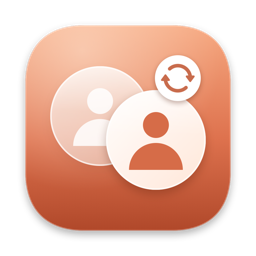
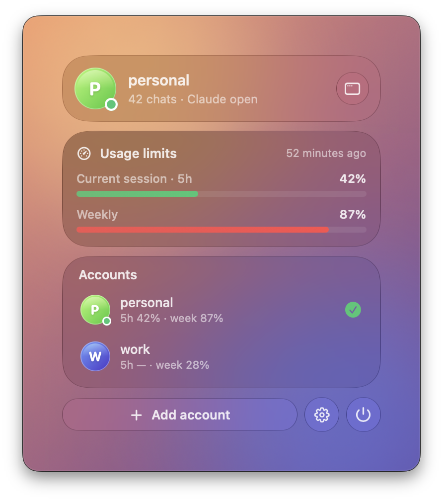
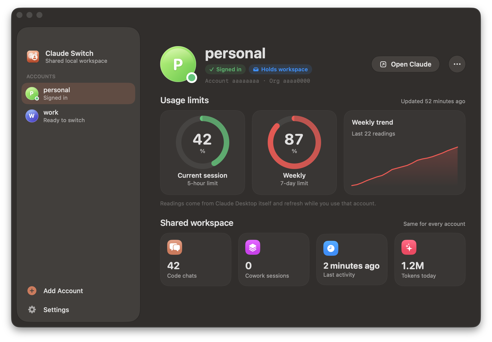

<p align="center">
  
</p>

<h1 align="center">Claude Switch</h1>

<p align="center">
  <a href="README.md">English</a> | <b>Русский</b>
</p>

<p align="center">
  <b>Переключение аккаунтов в Claude Desktop на macOS, при котором локальные чаты остаются общими.</b><br>
  Нативное приложение в строке меню с Liquid Glass, лимиты всегда на виду, плюс CLI.
</p>

<p align="center">
  
  &nbsp;
  
</p>

Обычно, если выйти из Claude Desktop и войти в другой аккаунт, вкладка Code (и Cowork) оказывается пустой: локальные сессии привязаны к аккаунту. Claude Switch хранит входы нескольких аккаунтов и переключает их одним кликом в строке меню, а все локальные чаты переезжают вместе с тобой в тот аккаунт, который сейчас активен.

То же самое можно делать из терминала:

```text
$ claude-switch list
 ● main                 c4d2a3b1/fb6c95e4  active  ← workspace
   work                 9a1e77f0/2b4d1c88  sign-in saved

$ claude-switch use work
[12:04:10] Quitting Claude… (confirm if the app asks)
[12:04:13] Sign-in for 'main' saved
[12:04:13] Moving workspace c4d2a3b1/fb6c95e4 → 9a1e77f0/2b4d1c88
[12:04:13] Switched to 'work'. Launching Claude.
```

Интерфейс программы (вывод команд, меню, уведомления) на английском.

- **Живёт в строке меню.** Стеклянная панель в стиле Пункта управления: кто сейчас вошёл, лимиты на 5 часов и неделю, все аккаунты в один клик.
- **Лимиты по каждому аккаунту.** Текущая сессия (5 часов) и недельный лимит с графиком тренда, по данным самого Claude Desktop.
- **Переключение в один клик.** Из строки меню, из окна приложения или командой `claude-switch use <имя>`.
- **Общий локальный воркспейс.** Сессии Code и Cowork, запланированные задачи, группы в сайдбаре, режимы прав для папок и пресеты переносятся при каждом переключении.
- **Без повторного логина.** Вход каждого аккаунта сохраняется локально и возвращается при переключении.
- **Бэкап перед каждым действием.** Хранятся последние 8 в `~/.claude-switch/backups/`.
- **Нативное и лёгкое.** SwiftUI с настоящим Liquid Glass на macOS 26 и новее (на старых системах обычная полупрозрачность); движок переключения — один файл на Python без зависимостей.

> [!IMPORTANT]
> Это неофициальный инструмент, он никак не связан с Anthropic. Он опирается на внутреннюю структуру данных Claude Desktop, которая может поменяться с обновлением приложения. Проверено на Claude Desktop 4.4212 (macOS, Apple Silicon).

## Содержание

- [Требования](#требования)
- [Установка](#установка)
- [Быстрый старт](#быстрый-старт)
- [Команды](#команды)
- [Приложение Claude Switch](#приложение-claude-switch)
- [Сборка из исходников](#сборка-из-исходников)
- [Что переносится, а что нет](#что-переносится-а-что-нет)
- [Как это работает](#как-это-работает)
- [Бэкапы и восстановление](#бэкапы-и-восстановление)
- [Решение проблем](#решение-проблем)
- [Безопасность и приватность](#безопасность-и-приватность)
- [Обновление и удаление](#обновление-и-удаление)

## Требования

- macOS 13 Ventura или новее (Liquid Glass — на macOS 26 Tahoe и новее)
- [Claude Desktop](https://claude.ai/download) в `/Applications`
- Python 3.8+. Он есть, если установлены Xcode Command Line Tools; если нет: `xcode-select --install`

## Установка

Одной командой в Терминале:

```bash
curl -fsSL https://raw.githubusercontent.com/qxlies/claude-switch/main/install.sh | bash
```

Установщик:

1. скачивает приложение **Claude Switch** (универсальное: Apple Silicon и Intel) из последнего релиза в `~/Applications` и запускает его, значок появляется в строке меню;
2. кладёт команду `claude-switch` в `~/.local/bin` и при необходимости добавляет эту папку в `PATH` (в `~/.zshrc`).

<details>
<summary>Установка вручную, из клона репозитория</summary>

```bash
git clone https://github.com/qxlies/claude-switch.git
cd claude-switch
CLAUDE_SWITCH_SRC=./claude-switch ./install.sh
```

Чтобы поставить собственную сборку приложения, передай её установщику: `CLAUDE_SWITCH_APP_ZIP=app/build/ClaudeSwitch.zip`. См. [Сборка из исходников](#сборка-из-исходников).

</details>

## Быстрый старт

### В приложении

1. Нажми значок Claude Switch в строке меню и открой окно (кнопка с иконкой окна) или запусти приложение через Spotlight.
2. Нажми **Save current account** и дай аккаунту имя, например `main`.
3. Нажми **＋ Add account**, введи имя и **Continue**. Claude откроется на экране входа: войди во второй аккаунт **через claude.ai**. Приложение само заметит вход и перенесёт чаты.
4. Дальше переключайся из строки меню: наведи на аккаунт и нажми **Switch**.

### В терминале

> [!WARNING]
> Запускай команды из **обычного Терминала**, а не из встроенного терминала или чата Claude: при переключении Claude закрывается и перезапускается. Если запустить изнутри, ничего не сломается (работа продолжится в фоне), но окно с выводом закроется.

**1. Запомни текущий аккаунт.** Claude при этом не перезапускается.

```bash
claude-switch save main
```

**2. Добавь второй аккаунт.**

```bash
claude-switch add work
```

Claude закроется и откроется на экране входа. Войди во второй аккаунт **через claude.ai**. Скрипт сам заметит вход, перенесёт чаты под новый аккаунт и перезапустит Claude. Если не войти за 15 минут, скрипт вернёт прежний аккаунт.

**3. Переключайся.**

```bash
claude-switch use main
claude-switch use work
```


## Команды

| Команда | Что делает |
| --- | --- |
| `claude-switch` | Список профилей и подсказка по командам |
| `claude-switch list` | Список профилей: `●` — текущий вход, `← воркспейс` — где сейчас лежат чаты |
| `claude-switch save <имя>` | Запомнить текущий вход как профиль; если он уже сохранён, переименовать |
| `claude-switch add <имя>` | Добавить новый аккаунт через экран входа |
| `claude-switch use <имя>` | Переключиться на профиль |
| `claude-switch sync` | Перенести чаты к аккаунту, который залогинен сейчас (если входил мимо скрипта) |
| `claude-switch rename <старое> <новое>` | Переименовать профиль |
| `claude-switch status` | Всё состояние в JSON (аккаунты, лимиты, воркспейс); им пользуется приложение |
| `claude-switch remove <имя>` | Удалить профиль: только сохранённый вход, чаты не трогаются |
| `claude-switch gui` | Простое меню выбора аккаунта в диалоге macOS (если приложения нет) |
| `claude-switch update` | Обновиться до последней версии |
| `claude-switch uninstall [--purge]` | Удалить программу; `--purge` удаляет также профили и бэкапы |
| `claude-switch --version` | Версия |

У `use`, `add` и `sync` есть флаг `--force`: если Claude не закрывается за минуту (например, висит диалог подтверждения), скрипт завершит его через `SIGTERM`.

Имя профиля может содержать буквы, цифры, `-`, `_` и `.`, без пробелов.

## Приложение Claude Switch

### Панель в строке меню

Нажми значок в строке меню (рядом с ним можно показывать недельный лимит активного аккаунта). Откроется плавающая стеклянная панель в стиле Пункта управления:

- **кто сейчас вошёл**, сколько общих чатов и открыт ли Claude;
- **лимиты**: текущая 5-часовая сессия и недельный лимит, со временем последнего замера;
- **аккаунты**, у каждого свои лимиты; наведи на аккаунт и нажми **Switch**;
- **＋ Add account**, настройки и выход.

Во время переключения панель показывает прогресс. Если ты вошёл в другой аккаунт прямо в Claude, она предложит **перенести чаты** к нему.

### Основное окно

Открывается из панели или через Spotlight. В сайдбаре — аккаунты, для каждого видно:

- кольца лимитов на 5 часов и неделю и график недельного тренда;
- общий воркспейс: чаты Code, сессии Cowork, последняя активность и токены за сегодня;
- **Switch to …** (или **Open Claude** у активного аккаунта) и меню **…** с переименованием, бэкапами, логом и удалением.

В **Settings**: запуск при входе в систему, недельный лимит в строке меню, значок в Dock (по умолчанию он есть, только пока открыто окно) и установка команды `claude-switch`.

> [!NOTE]
> Лимиты берутся из замеров самого Claude Desktop (`plan-usage-history.json`), поэтому цифры аккаунта обновляются, пока ты им пользуешься. У остальных аккаунтов видны последние известные значения. Замер 5-часового лимита старше пяти часов показывается приглушённым: это окно уже сбросилось.

> [!NOTE]
> При первом переключении macOS спросит, разрешить ли Claude Switch управлять Claude. Разреши, иначе он не сможет закрыть и открыть Claude.

## Что переносится, а что нет

| Переносится между аккаунтами | Остаётся у своего аккаунта |
| --- | --- |
| Локальные сессии Code (вся история чатов) | Чаты на claude.ai и в облаке |
| Сессии Cowork и запланированные задачи | Облачные сессии и Remote Control |
| Группы и разделы в сайдбаре Code | Коннекторы и MCP организации |
| Режимы прав для папок, пресеты сессий | Лимиты и подписка аккаунта |
| Временные папки (scratch) сессий | Сессии режима Gateway (3P), у него отдельная папка данных |

Сами транскрипты Claude Code лежат в `~/.claude/projects` и от аккаунта не зависят, они общие всегда.

Терминальная команда `claude` (Claude Code CLI) не затрагивается: у неё своя авторизация.

## Как это работает

<details>
<summary>Подробности для любопытных</summary>

Данные Claude Desktop лежат в `~/Library/Application Support/Claude`.

**Авторизация** — это cookies claude.ai (файл `Cookies`, `sessionKey*`), веб-хранилище (`Local Storage`, `Session Storage`, `IndexedDB`) и ключи `oauth:tokenCache*` в `config.json`. Всё зашифровано ключом из Связки ключей «Claude Safe Storage», а он один для всех аккаунтов на этом Mac. Поэтому снимок входа можно сохранить и вернуть, пока приложение закрыто.

**Локальные сессии** лежат в

```text
claude-code-sessions/<ID аккаунта>/<ID организации>/
local-agent-mode-sessions/<ID аккаунта>/<ID организации>/
```

Под другим аккаунтом приложение ищет сессии в другой папке, поэтому они «пропадают». Симлинк не подходит: приложение открывает эти папки с `O_NOFOLLOW` и считает симлинк подменой. Поэтому при переключении папка физически переносится под ID нового аккаунта (`rename`, мгновенно). При конфликте файлов побеждает переносимый воркспейс, а вторая версия уходит в бэкап.

**Переключение `use`:**

1. Claude закрывается штатно (AppleScript `quit`).
2. Снимок входа текущего аккаунта обновляется: токены периодически обновляются, поэтому снимок делается каждый раз.
3. Создаётся бэкап конфигов и сессий.
4. Возвращается вход целевого аккаунта, `lastKnownAccountUuid` выставляется на него. Без этого приложение решит, что сменился человек, и сбросит кэш токенов и коннекторы.
5. Воркспейс переносится, настройки, привязанные к аккаунту, копируются.
6. Выбор режима ставится на claude.ai, и Claude запускается.

**Про режим Gateway (3P).** Если в Claude Desktop настроен Gateway, приложение при старте без входа в claude.ai само переключается в Gateway (флаг `deploymentMode` в `~/Library/Application Support/Claude-3p/claude_desktop_config.json`). Скрипт выставляет `deploymentMode: "1p"` и запускает Claude с `--claude-first-party-sign-in`, как это делает само приложение при выборе входа через claude.ai.

Состояние скрипта лежит в `~/.claude-switch/`:

```text
state.json            профили и где сейчас лежит воркспейс
profiles/<имя>/auth/  сохранённый вход аккаунта
backups/              последние 8 бэкапов
switch.log            лог фоновых операций
```

</details>

## Сборка из исходников

Нужны Xcode Command Line Tools (`xcode-select --install`).

```bash
git clone https://github.com/qxlies/claude-switch.git
cd claude-switch
./app/build.sh --zip                       # → app/build/Claude Switch.app и ClaudeSwitch.zip
CLAUDE_SWITCH_SRC=./claude-switch CLAUDE_SWITCH_APP_ZIP=app/build/ClaudeSwitch.zip ./install.sh
```

Приложение собирается обычным `swiftc` (без проекта Xcode), универсальным бинарником, с ad-hoc подписью. Liquid Glass (`NSGlassEffectView`) оно находит во время работы, поэтому собирается и со старыми SDK, а на macOS до 26 использует обычную полупрозрачность.

```text
claude-switch          движок переключения (Python, только stdlib); приложение несёт его копию
install.sh             установщик
app/Sources/           SwiftUI-приложение: панель в строке меню, окно, стеклянные компоненты
app/tools/make-icon.swift   рисует иконку
app/build.sh           собирает, упаковывает, подписывает и архивирует приложение
```

## Бэкапы и восстановление

Перед каждым `use`, `add` и `sync` в `~/.claude-switch/backups/<дата>-<действие>/` сохраняются `config.json`, `claude_desktop_config.json`, `ccd-session-presets.json` и папки `claude-code-sessions` и `local-agent-mode-sessions`.

Если что-то пошло не так, восстановление вручную:

```bash
osascript -e 'quit app "Claude"'
B=~/.claude-switch/backups/<нужный-бэкап>
D=~/Library/Application\ Support/Claude
cp "$B"/*.json "$D"/
rsync -a "$B/claude-code-sessions/" "$D/claude-code-sessions/"
rsync -a "$B/local-agent-mode-sessions/" "$D/local-agent-mode-sessions/"
open -a Claude
```

`rsync` без `--delete` только добавляет файлы, ничего не удаляет. Если после восстановления чаты лежат не под текущим аккаунтом, выполни `claude-switch sync`.

## Решение проблем

**После переключения открылся экран входа.**
Сохранённый вход истёк: обычно такое бывает, если аккаунтом не пользовались около месяца, или если из него вышли на другом устройстве с опцией «выйти везде». Просто войди заново: скрипт обновит снимок при следующем переключении.

**Claude открылся в режиме Gateway.**
В версии 1.1.0 это исправлено, обновись: `claude-switch update`. Если всё же попал в Gateway, нажми «Выйти» и войди через claude.ai.

**Чаты пропали после входа в другой аккаунт прямо в Claude.**
Они не удалены, а лежат под предыдущим аккаунтом. Выполни `claude-switch sync`. Чтобы так не происходило, не пользуйся «Выйти» внутри Claude, переключайся через скрипт.

**«Claude did not quit».**
Скорее всего, Claude показал диалог подтверждения (например, есть работающие сессии). Подтверди его или запусти команду с `--force`.

**`command not found: claude-switch`.**
Открой новое окно терминала. Если не помогло, добавь в `~/.zshrc` строку `export PATH="$HOME/.local/bin:$PATH"`.

**Где смотреть подробности.**
Лог скрипта: `~/.claude-switch/switch.log`. Логи Claude: `~/Library/Logs/Claude/main.log`.

## Безопасность и приватность

- Всё работает локально: скрипт никуда ничего не отправляет и ни с какими серверами не связывается (кроме GitHub в команде `update`).
- Сохранённые входы лежат в `~/.claude-switch/profiles` с правами `700` (доступ только у твоего пользователя macOS). Они зашифрованы ключом Claude из Связки ключей, поэтому на другом компьютере бесполезны.
- Не публикуй и не пересылай папку `~/.claude-switch`: на этом Mac в ней сохранены входы в аккаунты.

## Обновление и удаление

```bash
claude-switch update             # последняя версия с GitHub
claude-switch uninstall          # удалить команду и приложение, профили оставить
claude-switch uninstall --purge  # удалить вообще всё, включая сохранённые входы и бэкапы
```

Чаты при удалении не трогаются: они остаются в папке того аккаунта, который активен сейчас.

## Лицензия

[MIT](LICENSE)
